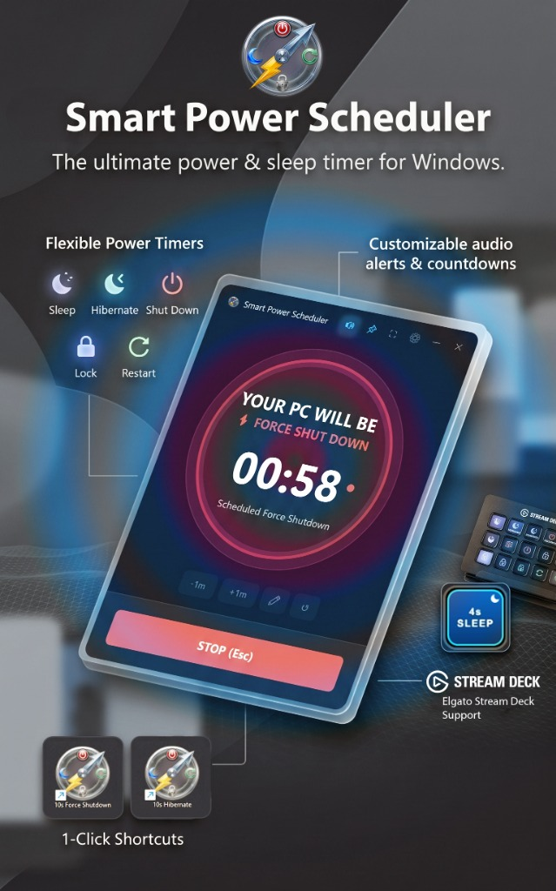

<div align="center">
  
  <h1>Smart Power Scheduler</h1>
  <p><b>The ultimate power & sleep timer for Windows.</b></p>
  <p>A clean, compact power timer for Windows that puts your PC to sleep, hibernates, shuts down, locks, or restarts on your schedule.</p>
</div>

<p align="center">
  
</p>

---

## ✨ Features

- **Flexible Power Timers**: Set a countdown to **Sleep**, **Hibernate**, **Shut Down**, **Lock**, or **Restart** (with optional **Force** modes for stubborn programs). Includes customizable audio alerts so you know when the timer is winding down.
- **Easy to Pause or Cancel**: Plans change? Pause or stop the countdown at any time with a single click. A soft red pulsing glow warns you in the final 30 seconds so nothing happens by surprise.
- **Built-in Elgato Stream Deck Plugin**: Included right inside the installer—no separate downloads or third-party stores needed. See the live countdown and trigger routines directly with hardware buttons.
- **1-Click Desktop Shortcuts**: Skip opening the app and adjusting sliders every day. Create custom desktop shortcuts for your daily routines (e.g., *"Sleep in 5m"*) and launch them straight from your desktop, taskbar, or Start Menu.
- **Custom App Protection (Beta)**: Pick running apps or browse `.exe` files to safeguard your active work (such as Photoshop, Blender, Word, or games). The countdown automatically pauses if your chosen applications are still running to prevent unsaved data loss.
- **Sleep Blocker Detection**: Warns you if background tools like **DontSleep**, **Caffeine**, or **PowerToys Awake** are secretly preventing Windows from sleeping.
- **Clean Windows Design**: Modern Fluent interface supporting Windows 11 Mica and Windows 10 Acrylic, with automatic Dark/Light theme switching.
- **Power History**: Automatically logs your sessions and tracks how many hours your PC spent asleep or powered off before waking up.

---

## ⌨️ Keyboard Shortcuts

| Shortcut | Action |
| :--- | :--- |
| <kbd>Esc</kbd> | Immediately stop timer / Close settings / Exit fullscreen |
| <kbd>Space</kbd> | Pause or Resume countdown |
| <kbd>F11</kbd> | Toggle Fullscreen mode |

---

## ⚡ Quick Shortcut

You can run `SmartPowerScheduler.exe` directly with flags or bind them to desktop shortcuts:

| Routine | Example Command | Description |
| :--- | :--- | :--- |
| **Quick Sleep** | `SmartPowerScheduler.exe --action sleep --time 5m --sound on` | Sleeps PC in 5 minutes with audio alert |
| **Emergency Off** | `SmartPowerScheduler.exe --action force-shutdown --time 15s` | Bypasses stuck apps & shuts down immediately |
| **Workstation Lock** | `SmartPowerScheduler.exe --action lock --time 10m` | Locks Windows in 10 minutes |
| **Silent Night** | `SmartPowerScheduler.exe --action sleep --time 1h --mute` | Runs silently without ticking or alarms |

---

## 📥 Download & Installation

Grab the latest release installer from the [Releases page](https://github.com/chandrath/Smart-Sleep-Scheduler/releases):
- **`SmartPowerScheduler-Setup.exe` (Recommended)**: Complete standalone installer. Includes the full app, bundled Elgato Stream Deck plugin, and desktop shortcuts.
- **`SmartPowerScheduler-Setup-ReqDotNet10.exe`**: Smaller installer for users who already have the [.NET 10 Desktop Runtime](https://dotnet.microsoft.com/download) installed.

> [!NOTE]
> **Windows SmartScreen / "Unknown Publisher" Warning**
> As an open-source project without expensive commercial code-signing certificates, Windows SmartScreen may show a prompt when running the installer for the first time.
>
> To proceed: click **"More info"** → **"Run anyway"**. The entire codebase is 100% open-source and built transparently using GitHub Actions.

---

<details>
<summary>🛠️ <b>Developer & Build Instructions</b></summary>

### Building Locally

Run the build pipeline using PowerShell:

```powershell
# Automatically builds release packages using the version from DevConfig.json:
.\build.ps1

# (Optional) Override version tag manually:
.\build.ps1 -VersionTag "vX.Y.Z"
```

All compiled packages will be placed into the `artifacts/` directory with generated SHA256 checksums.

### Architecture & Single Source of Truth (SSOT)

All project metadata, versioning, default parameters, and threshold limits are centrally managed in:
📁 `src/Smart-Power-Scheduler-Win/Config/DevConfig.json`

</details>

---

## 📄 License

GNU General Public License v3.0 (GPL-3.0)
